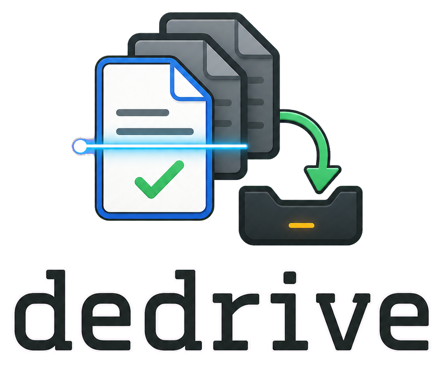

  
   
  <!-- repo-tagline:start -->
  <strong>🔍 Find duplicate Google Drive files with a private cleanup workflow 🧹</strong>
  <!-- repo-tagline:end -->

[Live Demo](https://dedrive.tsilva.eu)

dedrive finds exact duplicates in your Google Drive and lets you choose which
copies to keep. It runs in your browser and groups eligible files by checksum.

## Try it

Open the demo to walk through a cleanup with sample files, or choose
**Find duplicates** to connect your Drive.

1. Sign in with read-only access and scan your files.
2. Review each group and select every copy you want to keep.
3. Grant write access when you are ready to move the remaining copies to a
   private `_dupes` folder. The app revokes access after execution. Files are
   never permanently deleted.

The scan covers files you own in My Drive. It skips native Google Docs and
Sheets because they lack checksums.

See the [setup and cleanup guide](docs/guide.md) for local installation,
filters, review controls, and move behavior, or
[production delivery](docs/production-delivery.md) for deployment.

## License

[MIT License](LICENSE).
